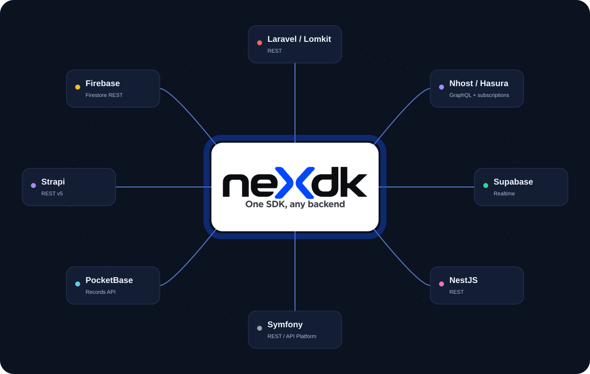

<p align="center">
  
</p>

<p align="center">
  <a href="https://github.com/techmefr/nexdk/actions/workflows/ci.yml"></a>
  
  
  
  <a href="LICENSE"></a>
</p>

<p align="center">
  <a href="https://techmefr.github.io/nexdk/"><b>Documentation</b></a> ·
  <a href="https://techmefr.github.io/nexdk/guides/writing-a-driver/">Write a driver</a> ·
  <a href="#drivers">Drivers</a>
</p>

# nexdk

Driver-based SDK. Talk to REST, GraphQL and WebSocket backends through **one
resource grammar** — the calling code never knows which protocol is behind a
resource.

> **Keywords** — `sdk` · `typescript` · `driver` · `rest` · `graphql` · `websocket` ·
> `realtime` · `standard-schema` · `zod` · `laravel` · `lomkit` · `nestjs` · `symfony` ·
> `supabase` · `nhost` · `hasura` · `vue` · `backend-agnostic` · `type-safe`

## Why nexdk

| Feature | What you get |
|---|---|
| 🔌 **Backend-agnostic** | Swap Laravel for Supabase without touching call sites. |
| 🧬 **End-to-end types** | Return types are inferred from your schema. |
| 🪶 **Zero dependencies** | The core depends on nothing; validators plug in via Standard Schema. |
| 🧩 **Driver ecosystem** | Official drivers ship independently; write your own in minutes. |
| ⚡ **Realtime-ready** | Subscriptions and events share the same grammar. |

```
sdk.[driver].[resource].[method](payload?, onEvent?, extra?)
```

## Install

```bash
pnpm add nexdk zod
# plus the driver(s) you need, e.g. @nexdk/driver-lomkit
```

## Usage

```ts
import { createSdk, defineResource } from 'nexdk'
import { z } from 'zod'

const product = defineResource({
  name: 'products',
  schema: z.object({ id: z.number(), name: z.string(), price: z.number() }),
})

const sdk = createSdk({
  drivers: { lomkit },                 // any object implementing SdkDriver
  resources: { lomkit: { products: product } },
})

// Fully typed: return type carries z.infer<product.schema>
const { data } = await sdk.lomkit.products.get({})
```

- **`defineResource({ name, schema, fragments?, relations? })`** — declare a
  resource once. `schema` is any [Standard Schema](https://standardschema.dev)
  validator (Zod, Valibot, ArkType…) — the single source of truth for the
  resource's inferred type.
- **`createSdk({ drivers, resources?, notify? })`** — binds resources to
  drivers and returns a typed SDK. The event handler is structural, so an event
  layer (e.g. [`beepr`](https://www.npmjs.com/package/beepr)) is optional.
- **`extra`** (4th method arg) — opaque at the core level; a driver may give it
  its own meaning (e.g. `@nexdk/driver-nhost` uses it for GraphQL fragment
  selection). Mocking is not a core concept — pair with
  [`chaff`](https://www.npmjs.com/package/chaff) in application code if you
  want it.

## Drivers

Official drivers (`@nexdk/driver-*`) live in `packages/drivers/`, peer-depend
on `nexdk` only, and ship independently on npm.

**Available:**

- [`@nexdk/driver-lomkit`](packages/drivers/lomkit) — Laravel + Lomkit REST API
- [`@nexdk/driver-nhost`](packages/drivers/nhost) — Hasura GraphQL + subscriptions
- [`@nexdk/driver-supabase`](packages/drivers/supabase) — Supabase realtime
- [`@nexdk/driver-nest`](packages/drivers/nest) — conventional NestJS REST CRUD
- [`@nexdk/driver-symfony`](packages/drivers/symfony) — Symfony / API Platform (Hydra)

**Roadmap**, in priority order:

1. Firebase
2. Appwrite
3. PocketBase
4. Convex
5. Hasura (standalone, no nhost auth wrapper)
6. Directus
7. Strapi
8. AdonisJS
9. WordPress REST API
10. Django REST Framework
11. Rails (JSON:API)

Community drivers use the `nexdk-driver-*` naming convention and live in their
own repo — see [Writing a driver](https://techmefr.github.io/nexdk/guides/writing-a-driver/).

## License

MIT © techmefr
