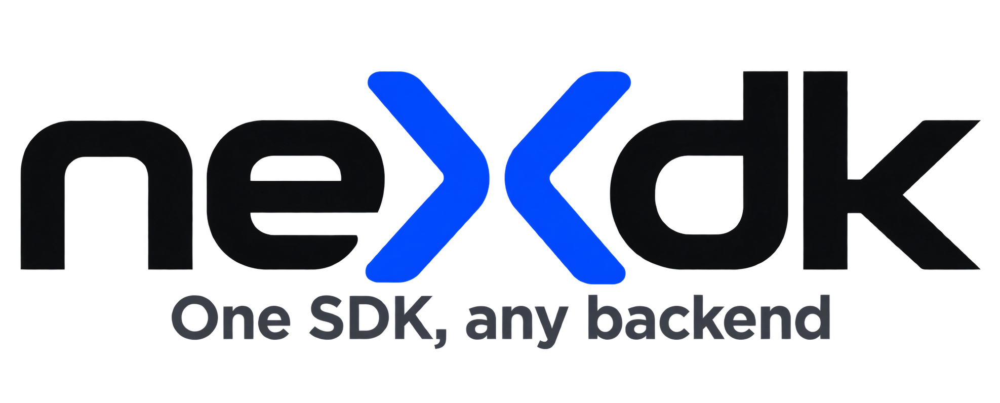
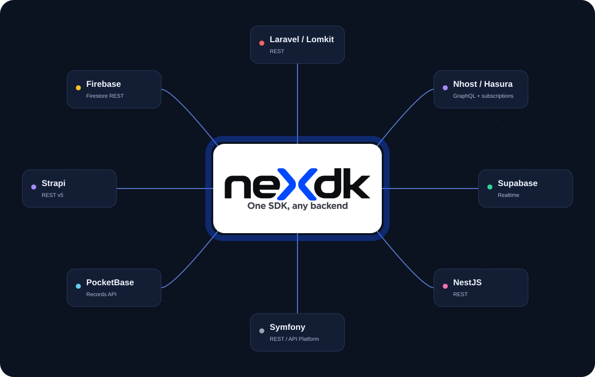

<p align="center">
  <a href="https://techmefr.github.io/nexdk/"></a>
</p>

<p align="center">
  
</p>

<p align="center">
  <a href="https://github.com/techmefr/nexdk/actions/workflows/ci.yml"></a>
  
  
  
  <a href="LICENSE"></a>
</p>

<p align="center">
  <a href="https://techmefr.github.io/nexdk/"><b>Documentation</b></a> ·
  <a href="https://techmefr.github.io/nexdk/guides/writing-a-driver/">Write a driver</a> ·
  <a href="#drivers">Drivers</a> ·
  <a href="#ecosystem">Ecosystem</a>
</p>

# neXdk

Driver-based SDK. Talk to REST, GraphQL and WebSocket backends through **one resource grammar**. The calling code never knows which protocol is behind a resource.

> **Keywords** — `sdk` · `typescript` · `driver` · `rest` · `graphql` · `websocket` ·
> `realtime` · `standard-schema` · `zod` · `laravel` · `lomkit` · `nestjs` · `symfony` ·
> `supabase` · `nhost` · `hasura` · `pocketbase` · `strapi` · `firebase` · `vue` · `backend-agnostic` · `type-safe`

## Why nexdk

| Feature | What you get |
|---|---|
| 🔌 **Backend-agnostic** | Swap Laravel for Supabase without touching call sites. |
| 🧬 **End-to-end types** | Return types are inferred from your schema. |
| 🪶 **Zero dependencies** | The core depends on nothing; validators plug in via Standard Schema. |
| 🧩 **Driver ecosystem** | Official drivers ship independently; write your own in minutes. |
| ⚡ **Realtime-ready** | Subscriptions and events share the same grammar. |

```
sdk.[driver].[resource].[method](payload?, onEvent?, extra?)
```

## Install

nexdk is not published to npm yet. Clone the repository and build it:

```bash
git clone https://github.com/techmefr/nexdk.git
cd nexdk
pnpm install
pnpm build
pnpm --filter "./packages/**" build
```

## Usage

```ts
import { createSdk, defineResource } from 'nexdk'
import { LomkitDriver } from '@nexdk/driver-lomkit'
import { z } from 'zod'

const product = defineResource({
  name: 'products',
  schema: z.object({ id: z.number(), name: z.string(), price: z.number() }),
})

const sdk = createSdk({
  drivers: { lomkit: new LomkitDriver({ baseUrl: 'https://api.example.com' }) },
  resources: { lomkit: { products: product } },
})

const { data } = await sdk.lomkit.products.get({
  search: { filters: [{ field: 'price', operator: '<', value: 100 }] },
})
```

`data` is typed as `{ id: number; name: string; price: number }[]`.

- **`defineResource({ name, schema, fragments?, relations? })`**: declares a resource. `schema` is any [Standard Schema](https://standardschema.dev) validator (Zod, Valibot, ArkType).
- **`createSdk({ drivers, resources?, notify? })`**: binds resources to drivers and returns the typed SDK. `notify` runs on every call, together with the per-call `onEvent`. Each handler is isolated: if one throws, the other still runs.
- **`defineDriver({ name, setup, methods })`**: authors a driver. It emits `request`, `success` and `error` for you.
- **`extra`** (third argument): opaque to the core. nhost reads `{ fragment }` from it.

Errors: a driver emits `error`, then throws. Drivers built on `@nexdk/http` emit `{ message, status, errors }`.

## Drivers

Official drivers live in `packages/drivers/` and peer-depend on `nexdk` only.

- [`@nexdk/driver-lomkit`](packages/drivers/lomkit): Laravel + Lomkit REST API
- [`@nexdk/driver-nhost`](packages/drivers/nhost): Hasura GraphQL and subscriptions
- [`@nexdk/driver-supabase`](packages/drivers/supabase): Supabase queries and realtime
- [`@nexdk/driver-nest`](packages/drivers/nest): conventional NestJS REST CRUD
- [`@nexdk/driver-symfony`](packages/drivers/symfony): Symfony / API Platform (Hydra)
- [`@nexdk/driver-pocketbase`](packages/drivers/pocketbase): PocketBase records API
- [`@nexdk/driver-strapi`](packages/drivers/strapi): Strapi v5 REST
- [`@nexdk/driver-firebase`](packages/drivers/firebase): Cloud Firestore REST

Shared packages: [`@nexdk/http`](packages/http) (REST toolkit) and [`@nexdk/hooks`](packages/hooks) (Vue forms).

The pocketbase, strapi and firebase drivers follow every page on `get`, unless you set the page size or the page yourself.

**Roadmap**, in priority order:

1. Appwrite
2. Directus
3. Django REST Framework
4. Generic GraphQL (any non-Hasura endpoint)
5. Convex
6. Firebase realtime listeners
7. Rails (JSON:API)
8. WordPress REST API
9. AdonisJS

Community drivers use the `nexdk-driver-*` naming convention. See [Writing a driver](https://techmefr.github.io/nexdk/guides/writing-a-driver/).

## Ecosystem

| Project | Role | Documentation |
|---|---|---|
| [neXdk](https://github.com/techmefr/nexdk) | One resource grammar for REST, GraphQL and WebSocket backends. | [Docs](https://techmefr.github.io/nexdk/) |
| [beepr](https://github.com/techmefr/beepr) | Typed notifications and debug output. | [Docs](https://techmefr.github.io/beepr/) |
| [shamock](https://github.com/techmefr/shamock) | Mock `fetch` without any dependency. | [Docs](https://techmefr.github.io/shamock/) |
| [dialectr](https://github.com/techmefr/dialectr) | Universal query builder (lomkit, PocketBase, Strapi adapters). | [Repository](https://github.com/techmefr/dialectr) |

Each project works alone. nexdk depends on none of them. None is published to npm yet. See [Ecosystem](https://techmefr.github.io/nexdk/guides/ecosystem/) to combine them, for example `toLomkit` from dialectr as the payload of the lomkit driver.

## License

MIT © techmefr
